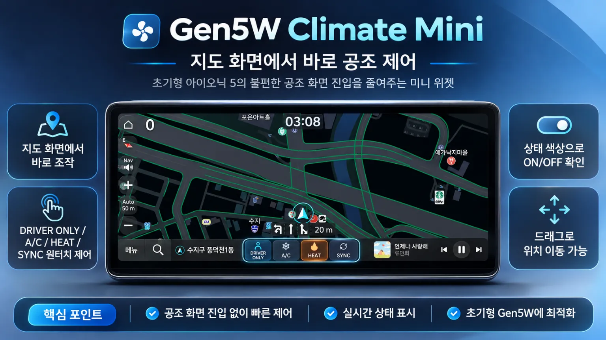
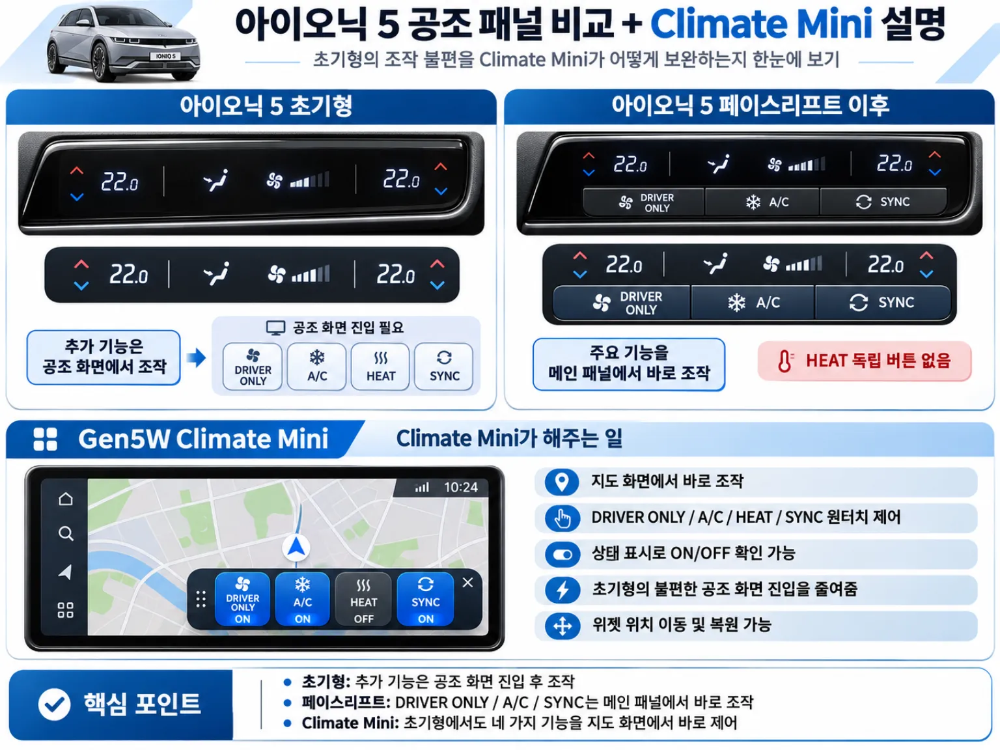

# Gen5W Climate Mini

## 한국어

**Gen5W Climate Mini**는 현대 **아이오닉 5 전용** NEMESIS 기반 미니 공조 제어 앱입니다.

지도 화면에서 별도의 공조 화면으로 이동하지 않고 **DRIVER ONLY · A/C · HEAT · SYNC** 기능을 조작할 수 있습니다.

### 주요 기능
- 네 가지 공조 기능 원터치 제어
- 색상으로 기능의 ON/OFF 상태 표시 (활성화: 파란색, HEAT: 주황색)
- 지도 화면 위젯 표시 및 다른 화면에서 자동 숨김
- 위젯 위치 이동·저장 및 재부팅 후 자동 복원

### 앱 소개

### 아이오닉 5 공조 패널 비교

### 정상 작동 확인 환경
- **차량:** 현대 아이오닉 5, 2022년식 한국형
- **인포테인먼트:** Gen5W
- **펌웨어:** V039
- **설치 환경:** NEMESIS

다른 연식 및 펌웨어와의 호환성은 확인되지 않았습니다.

---

## English

**Gen5W Climate Mini** is a compact NEMESIS-based climate control app designed for the **Hyundai IONIQ 5**.

It provides quick access to **DRIVER ONLY, A/C, HEAT, and SYNC** from a floating widget on the navigation map, without opening the full climate screen.

### Key Features
- One-touch control of four climate functions
- Color-coded status indication (blue for active functions, orange for HEAT)
- Automatic widget visibility according to the active screen
- Draggable widget with a saved position and restoration after reboot

### App Overview

### IONIQ 5 Climate Panel Comparison

### Verified Environment
- **Vehicle:** Hyundai IONIQ 5, Korean 2022 model
- **Infotainment:** Gen5W
- **Firmware:** V039
- **Installation:** NEMESIS

Compatibility with other model years and firmware versions has not been verified.

---

### [Download Latest Release](https://github.com/yong1045-code/gen5w-climate-mini/releases)
